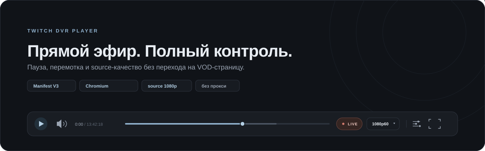

<div align="center">
  
  <h1>Twitch DVR Player</h1>
  <p><strong>Перемотка прямого эфира Twitch, пауза и source-качество — в одном плеере.</strong></p>
  <p>
    
    
    
    
  </p>
</div>

<p align="center">
  
</p>

> **Коротко:** расширение заменяет стандартный плеер на странице Twitch-канала на DVR-плеер. В России Twitch ограничивает качество прямого эфира, но запись текущей трансляции отдаёт source — расширение показывает именно её и добавляет нормальный таймлайн, паузу и перемотку. Это не VPN и не прокси.

## Содержание

- [Что это](#что-это)
- [Возможности](#возможности)
- [Как это работает](#как-это-работает)
- [Требования](#требования)
- [Установка](#установка)
- [Обновление](#обновление)
- [Использование](#использование)
- [Горячие клавиши](#горячие-клавиши)
- [Качество и задержка](#качество-и-задержка)
- [Ограничения](#ограничения)
- [Решение проблем](#решение-проблем)
- [FAQ](#faq)
- [Приватность и безопасность](#приватность-и-безопасность)
- [Структура проекта](#структура-проекта)
- [Разработка](#разработка)
- [Changelog](#changelog)
- [Лицензии](#лицензии)
- [Поддержка](#поддержка)

## Что это

**Twitch DVR Player** — расширение для Chrome и Яндекс Браузера, которое делает из прямого эфира полноценный плеер с перемоткой. Больше не нужно открывать вкладку «Видео», искать текущую трансляцию и мириться с кривым плеером VOD.

Расширение работает с **записью текущей трансляции**, которую Twitch создаёт во время эфира. Из этой записи берётся максимальное доступное качество (обычно source — 1080p, а если стример вещает в 2K, то и 2K), а таймлайн позволяет перематывать на любой момент уже прошедшего эфира.

> Важно: расширение **не обходит сетевые ограничения** и не использует VPN/прокси. Оно воспроизводит запись, которую Twitch и так отдаёт, и добавляет к ней DVR-интерфейс.

## Возможности

| Возможность | Что делает |
| --- | --- |
| **Полный DVR** | Таймлайн всей текущей трансляции, пауза, перемотка назад и кнопка «К эфиру». |
| **Максимальное качество** | По умолчанию выбирается source из записи текущего эфира; вручную можно выбрать 720p, 480p и ниже. |
| **DVR без VOD-страницы** | Всё происходит на странице канала. Чат Twitch остаётся на месте. |
| **Кнопка DVR в нативном плеере** | В стандартном плеере кнопка встроена в правую нижнюю панель, левее шестерёнки. Если панель недоступна — остаётся запасная кнопка в углу. |
| **Понятный звук** | Клик по динамику выключает звук и уводит ползунок в 0; иконка показывает уровень громкости одной, двумя или тремя волнами. |
| **Спокойный интерфейс** | Графитовая палитра, steel-blue акцент, плавные анимации и аккуратный плавающий control-dock. |
| **Безопасный fallback** | Если у канала отключены записи, расширение не ломает просмотр и оставляет стандартный плеер. |
| **Никакой телеметрии** | Все запросы идут только к Twitch; сторонней аналитики нет. |

## Как это работает

1. Расширение определяет живой канал и находит запись текущей трансляции.
2. Запись воспроизводится почти как live: HLS-сегменты подгружаются по мере появления.
3. При перемотке расширение запрашивает более старые сегменты записи и достраивает буфер.
4. В меню качества показываются дорожки из записи: source и транскоды Twitch.
5. DVR-плеер живёт в том же месте, где был обычный: чат, театральный режим и остальная страница не ломаются.

Из-за того, что используется запись эфира, видео идёт примерно **на 15–30 секунд позже настоящего live**, а чат — немного впереди. Это плата за source-качество и полноценную перемотку.

## Требования

| Что нужно | Подробности |
| --- | --- |
| **Браузер** | Chrome/Chromium **111+** или актуальный Яндекс Браузер. |
| **Twitch** | Канал в эфире и включённые записи трансляций (VOD). |
| **Интернет** | Стабильный канал под bitrate выбранного качества. Для source 1080p60 обычно нужно около 8 Мбит/с. |
| **Дополнительные программы** | Не требуются. Node нужен только для пересборки CSS при разработке. |

> На каналах с отключёнными VOD или с записями «только для подписчиков» полноценный DVR недоступен — останется стандартный плеер и кнопка DVR для повторной попытки.

## Установка

Расширение ставится как **unpacked**-расширение. В Chrome Web Store его нет; для локальной установки это нормальный и безопасный способ.

### Вариант 1. Скачать ZIP

1. Откройте [репозиторий](https://github.com/kirillbay325/twitch-dvr).
2. Нажмите **Code → Download ZIP**.
3. Распакуйте архив в постоянную папку, например `%USERPROFILE%\twitch-dvr`. Не оставляйте расширение в папке загрузок, если потом чистите её.
4. Внутри архива будет папка вида `twitch-dvr-main` — при установке выбирайте её или переименуйте в `twitch-dvr`. Главное, чтобы `manifest.json` лежал прямо в выбранной папке.

### Вариант 2. Клонировать через git

```bash
git clone https://github.com/kirillbay325/twitch-dvr.git
```

Папка `twitch-dvr` с `manifest.json` внутри и будет папкой расширения.

### Google Chrome

1. Откройте `chrome://extensions`.
2. Включите **Режим разработчика** (Developer mode) в правом верхнем углу.
3. Нажмите **Загрузить распакованное расширение** (Load unpacked).
4. Выберите папку `twitch-dvr` (в ней должен лежать `manifest.json`).
5. Откройте канал на Twitch и обновите страницу: `Ctrl+F5`.

### Яндекс Браузер

1. Откройте `browser://extensions`.
2. Включите **Режим разработчика**.
3. Нажмите **Загрузить распакованное расширение**.
4. Выберите папку `twitch-dvr` с `manifest.json`.
5. Обновите страницу канала: `Ctrl+F5`.

### Проверка установки

- На канале в эфире появится DVR-плеер с таймлайном и плавающей панелью управления.
- Если открыт стандартный плеер Twitch, кнопка **DVR** будет в правой нижней панели, левее шестерёнки. Если нативная панель недоступна — кнопка появится в правом верхнем углу видео.
- В настройках DVR-плеера (иконка с ползунками) внизу должна быть строка **«Версия 1.2.1»**.

> Выбирайте именно корневую папку расширения, а не `src` и не папку с архивом. Chrome должен видеть `manifest.json` сразу внутри выбранной папки.

## Обновление

1. Откройте `chrome://extensions` (в Яндексе — `browser://extensions`).
2. Найдите **Twitch DVR Player** и нажмите значок обновления на карточке.
3. Полностью обновите вкладку Twitch: `Ctrl+F5`.
4. Проверьте версию в настройках плеера.

Если версия не меняется, удалите расширение и загрузите папку заново: Chrome и Яндекс иногда кешируют unpacked-расширения. Актуальная версия — **1.2.1**.

## Использование

### Кнопка DVR в стандартном плеере

Когда показан обычный плеер Twitch, кнопка **DVR** встроена в правую нижнюю группу управления — **левее шестерёнки**. Нажмите её, страница перезагрузится, и включится DVR-плеер.

Если нативная панель не отрисовалась или Twitch изменил разметку, кнопка **DVR** останется в правом верхнем углу видео как запасной вариант.

Когда DVR-плеер активен, нативная панель скрыта. Чтобы вернуться к стандартному плееру, откройте настройки DVR (иконка с ползунками) и выберите **«Стандартный плеер Twitch»**.

### Управление

| Элемент | Действие |
| --- | --- |
| Таймлайн | Перемотка по всей текущей трансляции; подсказка показывает время. |
| Кнопка **LIVE / К ЭФИРУ** | Возвращает к последнему доступному моменту эфира. |
| Play / Pause | Пауза и продолжение. |
| Меню качества | Выбор source или другого доступного разрешения. |
| Динамик и ползунок | Громкость и mute; иконка меняет уровень. |
| Fullscreen | Полноэкранный режим DVR-плеера. |
| Настройки | Стандартный плеер, перезапуск DVR, информация о задержке и версии. |

### Звук

- Нажмите на динамик — громкость плавно уйдёт в **0%**, ползунок опустится, а иконка станет перечёркнутой.
- Повторное нажатие вернёт прежнюю громкость.
- Пока звук включён, иконка показывает уровень: одна волна — тихо, две — средне, три — громко.
- Ползунок громкости работает так же и синхронизирован с иконкой.

## Горячие клавиши

| Клавиши | Действие |
| --- | --- |
| <kbd>Space</kbd> / <kbd>K</kbd> | Пауза или продолжение |
| <kbd>←</kbd> / <kbd>→</kbd> | Перемотка на 10 секунд |
| <kbd>Shift</kbd> + <kbd>←</kbd> / <kbd>→</kbd> | Перемотка на 1 минуту |
| <kbd>J</kbd> / <kbd>L</kbd> | Перемотка на 10 секунд |
| <kbd>M</kbd> | Выключить или вернуть звук |
| <kbd>F</kbd> | Полноэкранный режим |
| <kbd>Esc</kbd> | Закрыть открытое меню |

Горячие клавиши не срабатывают, когда фокус находится в поле чата или другом текстовом поле.

## Качество и задержка

- Twitch ограничивает качество **прямого эфира** для зрителей из России. На практике потолок часто составляет 720p.
- Запись текущей трансляции при этом может отдавать **source**: 1080p60 или 2K, если стример вещает в таком качестве.
- Расширение по умолчанию выбирает максимальную доступную дорожку. Если интернет не тянет source, выберите 720p60 в меню качества.
- 2K/1440p появится **только если сам стример вещает в 2K**: Twitch не создаёт 2K-транскоды.
- DVR-плеер идёт на **15–30 секунд позже** настоящего live. Чат при этом опережает видео — это нормально для режима записи.

## Ограничения

- Нужны включённые записи трансляций (VOD). Если VOD отключены, DVR недоступен.
- Записи «только для подписчиков» не поддерживаются без авторизации.
- В DVR-плеере не отображаются реклама, оверлеи расширений Twitch, опросы, клипы поверх видео и другие слои стандартного плеера. Для них переключитесь на стандартный плеер.
- Это не способ смотреть «настоящий live» в 1080p: используется запись, поэтому есть задержка.
- Расширение не использует VPN/прокси и не обходит ограничения Twitch.
- Поддерживаются Chromium-браузеры для десктопа. Firefox и мобильные браузеры не поддерживаются.
- Twitch периодически меняет API и разметку. Если расширение перестало работать, проверьте обновления и консоль с фильтром `[TwitchDVR]`.

## Решение проблем

| Симптом | Причина | Что сделать |
| --- | --- | --- |
| DVR-плеер не включился, но в углу есть кнопка DVR | У канала отключены записи или текущая запись ещё не обработана | Нажмите DVR позже или включите VOD в настройках канала |
| Нет кнопки DVR в нативной панели | Twitch изменил панель или она ещё не отрисована | Используйте запасную кнопку DVR в правом верхнем углу; проверьте обновление |
| Долгий спиннер при запуске | Скачивается первый тяжёлый source-сегмент и запись ещё догоняет эфир | Подождите несколько секунд; при медленной сети выберите 720p60 |
| Видео подтормаживает | Source 1080p60 требует стабильные ~8 Мбит/с | Выберите качество ниже в меню |
| Нет звука после запуска | Chrome/Яндекс заблокировал автозапуск со звуком | Нажмите «Включить звук» в плеере |
| Старый интерфейс или нет новой кнопки DVR | Браузер оставил старую unpacked-версию | Обновите карточку расширения, затем `Ctrl+F5`; при необходимости удалите и загрузите заново |
| Ничего не происходит | Расширение выключено, открыт не канал или стрим офлайн | Проверьте `chrome://extensions`, откройте корень канала и обновите страницу |

Если ошибка повторяется, откройте DevTools (`F12`) → Console и отфильтруйте сообщения по `[TwitchDVR]`. При создании issue приложите версию браузера, версию расширения, название канала и текст ошибки. Не прикладывайте cookies, токены и другие приватные данные.

## FAQ

<details>
<summary>Почему в России доступно 1080p, если live-плеер ограничен 720p?</summary>

Расширение воспроизводит не прямой live-поток, а запись текущей трансляции. Запись отдаёт source-дорожку, которая не попадает под ограничение live-качества. Это не VPN и не прокси: используется тот же контент, который Twitch хранит для VOD.
</details>

<details>
<summary>Почему видео отстаёт от чата?</summary>

Запись трансляции появляется на несколько секунд позже live. Вместе с сегментом буфера задержка обычно составляет 15–30 секунд. Зато доступны source-качество и перемотка на любой момент эфира.
</details>

<details>
<summary>Можно ли смотреть 2K или 4K?</summary>

Только если стример сам ведёт трансляцию в 2K/4K и Twitch отдаёт это в source. Отдельных 2K-транскодов Twitch обычно не создаёт.
</details>

<details>
<summary>Почему DVR не работает на конкретном канале?</summary>

Скорее всего, у канала отключены записи трансляций (VOD) или записи доступны только подписчикам. В этом случае расширение оставляет стандартный плеер.
</details>

<details>
<summary>Реклама и расширения Twitch будут работать?</summary>

В DVR-плеере они не отображаются: это отдельный плеер, а не оверлей Twitch. Если нужны реклама, опросы, клипы или панели расширений, переключитесь на стандартный плеер через настройки.
</details>

<details>
<summary>Нужен ли аккаунт Twitch?</summary>

Для публичных трансляций и записей — нет. Для записей «только для подписчиков» потребуется авторизация, но расширение такие записи не поддерживает.
</details>

<details>
<summary>Это безопасно?</summary>

Да: исходный код открыт, расширение не содержит аналитики и не отправляет данные третьим лицам. Все запросы идут к Twitch (gql.twitch.tv и CDN Twitch). Подробности — в разделе [Приватность и безопасность](#приватность-и-безопасность).
</details>

## Приватность и безопасность

- **Нет телеметрии и аналитики.** Расширение не отправляет данные на сторонние серверы.
- **Только Twitch.** Запросы идут к `gql.twitch.tv`, `usher.ttvnw.net` и CDN Twitch; используются публичные playback-токены, без доступа к паролю и cookies аккаунта.
- **Локальные настройки.** Выбранное качество, громкость и режим плеера хранятся в `localStorage` на `twitch.tv`.
- **Без удалённого кода.** Все скрипты поставляются в репозитории; расширение не загружает и не исполняет код извне.
- **Минимум разрешений.** Content script работает только на `www.twitch.tv`; широкие разрешения браузера не запрашиваются.
- **Открытый код.** Лицензия MIT — можно проверить каждую строку и собрать свою версию.

Twitch и логотип Twitch являются товарными знаками Twitch Interactive, Inc. Проект не связан с Twitch Interactive и не одобрен ею.

## Структура проекта

```text
twitch-dvr/
├── manifest.json           # Manifest V3
├── src/
│   ├── player.js           # DVR-движок и UI
│   ├── styles.css          # исходные стили
│   └── styles-inline.js    # сгенерированный CSS-фолбэк
├── vendor/
│   ├── mux.min.js          # mux.js, TS → fMP4
│   └── LICENSE.muxjs.txt   # Apache-2.0
├── icons/
│   ├── icon48.png
│   └── icon128.png
├── docs/
│   └── hero.svg            # превью для README
├── scripts/
│   └── build-css.mjs       # пересборка styles-inline.js
├── README.md
├── LICENSE
└── THIRD_PARTY_NOTICES.md
```

## Разработка

Для использования расширения сборка не нужна: достаточно загрузить папку через **Load unpacked**.

- **JS и манифест** — изменения подхватываются после перезагрузки расширения и страницы.
- **CSS** — после правок в `src/styles.css` обязательно пересоберите встроенный фолбэк:

```bash
node scripts/build-css.mjs
```

- `src/styles-inline.js` генерируется автоматически; не редактируйте его вручную.
- Зависимостей и `npm install` нет. Node нужен только для скрипта пересборки CSS.
- Отладка: DevTools → Console, фильтр `[TwitchDVR]`.
- Ручная проверка перед релизом: кнопка DVR в нативной панели, source-качество, перемотка, возврат к live, уровни звука, переход на стандартный плеер.

## Changelog

| Версия | Изменения |
| --- | --- |
| **1.2.1** | Кнопка DVR встроена в нативную правую панель Twitch (левее шестерёнки); FAB оставлена как fallback. |
| **1.2.0** | Холодная graphite/steel-blue палитра, плавные анимации, уровни иконки громкости 1/2/3 и корректный mute со слайдером в 0. |
| **1.1.0** | Полный редизайн: плавающий control-dock, новые иконки, настройка звука. |
| **1.0.2** | Оверлей привязан к реальному прямоугольнику видео; исправлен оконный режим. |
| **1.0.1** | Самостоятельная инъекция CSS, если браузер не применил стили из манифеста. |
| **1.0.0** | Первый публичный выпуск. |

## Лицензии

- Код расширения — [MIT](LICENSE).
- `mux.js` — Apache-2.0; текст лицензии в [vendor/LICENSE.muxjs.txt](vendor/LICENSE.muxjs.txt).
- Сторонние компоненты и упоминания — [THIRD_PARTY_NOTICES.md](THIRD_PARTY_NOTICES.md).

## Поддержка

- **Нашли баг или что-то сломалось:** [создайте issue](https://github.com/kirillbay325/twitch-dvr/issues/new).
- Приложите версию браузера, версию расширения, название канала, шаги воспроизведения и ошибки из консоли с фильтром `[TwitchDVR]`.
- Не публикуйте cookies, токены, пароли и личные данные.
- Идеи и pull request'ы приветствуются.

<p align="center"><sub>Сделано для удобного DVR-просмотра Twitch. Не связано с Twitch Interactive.</sub></p>
